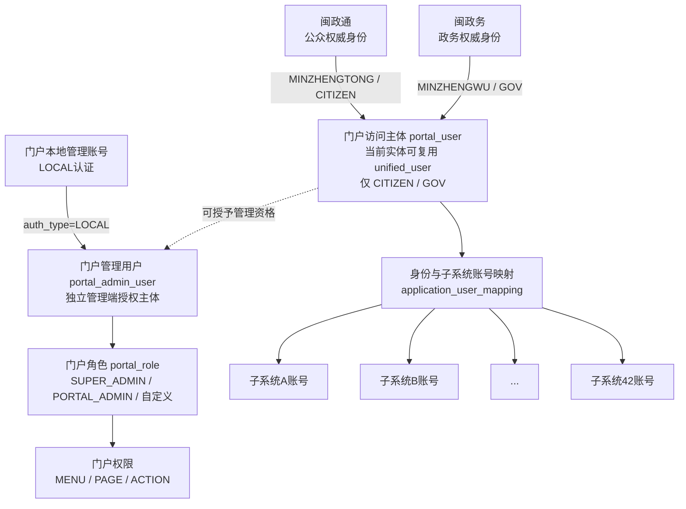
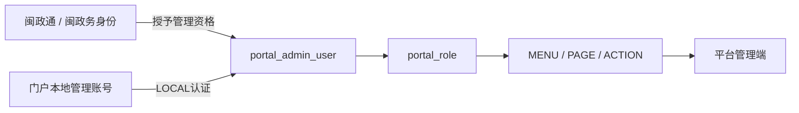
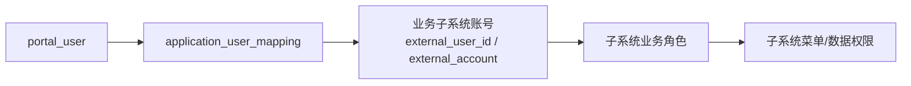

# 登录与用户体系

> 本文件为《卫健统一门户系统需求规格说明书》的用户、账号、登录、权限和子系统账号关系专项说明。  
> 当前业务基线：V20260921-01。  
> 若本文与主《卫健统一门户系统需求规格说明书》冲突，以主需求规格说明书为准，并同步修订本文。

---

## 1. 文档目标

本文件统一说明以下问题：

1. 闽政通、闽政务、统一门户、42个业务子系统分别管理什么；
2. 公众用户、政务用户、门户管理用户、本地管理账号之间是什么关系；
3. `portal_user`、`portal_admin_user`、门户角色、子系统账号分别代表什么；
4. 用户登录后如何形成 Portal Session；
5. 用户如何通过 DIRECT / BIND / REQUEST 进入业务子系统；
6. 门户为什么需要“身份与子系统账号映射”，以及映射到什么程度；
7. 哪些用户、账号、角色、权限属于门户，哪些明确属于业务子系统；
8. 42个子系统接入时需要提供哪些身份与账号能力。

本文不把“身份来源、用户类别、管理资格、门户角色、子系统账号、子系统业务权限”混为同一概念。

---

## 2. 用户与账号关系总图

### 2.1 总体关系



### 2.2 关键结论

- 用户端正式访问主体只有两类：**CITIZEN（公众）**、**GOV（政务）**。
- LOCAL 不是第三类普通门户用户，LOCAL 只是 `portal_admin_user` 的一种管理端认证方式。
- `portal_user` 与 `portal_admin_user` 是两个不同业务对象。
- 同一个闽政通/闽政务用户可以既是普通门户访问主体，也被额外授予管理资格。
- 门户角色只授予 `portal_admin_user`，不直接授予普通 `portal_user`。
- 子系统账号属于42个业务子系统，门户只维护必要映射，不把子系统账号收归门户统一管理。
- 子系统业务角色、菜单权限、数据权限由业务子系统自行管理。

---

## 3. 四类核心对象必须分开

| 对象 | 业务含义 | 是否门户拥有 | 主要用途 |
|---|---|---:|---|
| 外部身份 | 闽政通 / 闽政务返回的权威身份 | 否 | 证明“用户是谁” |
| 门户访问主体 `portal_user` | 用户端最小统一索引；当前数据实体可复用 `unified_user` | 是 | 用户端、应用、待办、消息、公告、账号映射 |
| 门户管理用户 `portal_admin_user` | 管理端独立授权主体 | 是 | 管理端登录、角色、权限、审计 |
| 子系统账号 | 42个子系统内部业务账号 | 否 | 子系统内部登录、业务角色、菜单和数据权限 |

不得使用一个“用户表”同时表达上述四类对象的全部语义。

---

## 4. 第一层：外部权威身份

### 4.1 正式身份来源

| 身份来源 | 用户类别 | 权威主体 | 主要入口 |
|---|---|---|---|
| MINZHENGTONG / 闽政通 | CITIZEN / 公众用户 | 闽政通 | 用户端 |
| MINZHENGWU / 闽政务 | GOV / 政务用户 | 闽政务 | 用户端 |

当前正式用户端模型只包含 CITIZEN、GOV。

法人/企业用户当前没有单独建立正式用户类型；如后续确认纳入，需要重新明确身份来源、登录方式、组织关系、应用适用范围和数据模型。

### 4.2 门户不负责的外部身份能力

门户不建设、不接管：

- 闽政通/闽政务开户注册；
- 上层实名核验；
- 上层账号密码；
- 上层账号启停；
- 上层身份生命周期；
- 上层短信验证码核心能力；
- 上层身份主数据维护。

### 4.3 外部身份建档与同步

门户不全量复制闽政通/闽政务用户库，采用：

**首次按需建档 + 登录时刷新 + 必要字段增量同步**

规则：

- 首次成功认证时，以外部稳定用户标识定位或建立门户访问主体；
- 后续登录刷新允许同步的姓名、手机号、组织等最小必要展示字段；
- 门户不自行修改外部权威主数据；
- 外部身份密码、长期认证凭据、生物识别模板不得进入门户业务数据表；
- 外部稳定用户ID优先作为身份定位依据，不使用姓名作为唯一键。

### 4.4 CITIZEN / GOV 跨身份源关系

CITIZEN 与 GOV 默认是两个独立访问身份，不自动合并为同一自然人。

如未来需要关联：

1. 优先使用上层提供的合法稳定跨源ID；
2. 没有稳定ID时，只能生成候选关系；
3. 姓名、已验证手机号只能辅助候选匹配，不能直接自动合并；
4. 必须经过闽政通/闽政务重新认证或上层更强身份核验；
5. 关联后仍保留两个外部身份来源和各自 external subject；
6. 关联、解除关联必须记录审计。

---

## 5. 第二层：门户访问主体 portal_user

### 5.1 业务定位

`portal_user` 表示“谁正在使用统一门户用户端”。

当前数据库/代码可继续复用 `unified_user` 作为数据实体，但业务含义应理解为：

> CITIZEN / GOV 的门户访问主体最小索引。

### 5.2 portal_user 承载的内容

用于：

- Portal Session；
- 用户端访问；
- 我的应用；
- 其它应用；
- 应用访问申请；
- 待办；
- 消息；
- 公告可见范围；
- 个人中心；
- 子系统账号映射；
- 用户端审计。

### 5.3 portal_user 不承载的内容

不承载：

- LOCAL 本地管理账号；
- 门户管理角色；
- 子系统业务角色；
- 子系统菜单权限；
- 子系统数据权限；
- 子系统账号密码。

### 5.4 用户类别与组织

- CITIZEN：公众用户，不强制所属组织；
- GOV：政务用户，可引用闽政务权威组织信息；
- 门户不得为了满足组织字段而给公众用户虚构组织。

---

## 6. 第三层：门户管理用户 portal_admin_user

### 6.1 业务定位

`portal_admin_user` 表示：

> 谁被授权进入和管理统一门户管理端。

管理端“用户管理”管理的是 `portal_admin_user`，不是所有登录过门户的 CITIZEN / GOV。

### 6.2 两种认证来源



#### EXTERNAL 管理用户

闽政通/闽政务用户被授予管理资格后：

- 仍保持原 CITIZEN / GOV 身份；
- 新增的是独立管理授权关系；
- 不复制成“本地用户”；
- 不改变原用户类别；
- 是否可以进入管理端由 `portal_admin_user.enabled + portal_role + portal_permission` 决定。

#### LOCAL 管理用户

用于：

- 初始化；
- 运维；
- 无法或不适合依赖上层身份的管理人员。

规则：

- LOCAL 直接属于 `portal_admin_user`；
- 不创建 LOCAL 类型的普通 `portal_user`；
- LOCAL 默认不参与普通用户应用访问和子系统账号映射；
- LOCAL 账号不因为存在就自动具有超级管理员权限，必须分配有效门户角色。

### 6.3 portal_admin_user 主要字段

至少包括：

- 管理用户ID；
- 管理账号；
- 姓名/展示信息；
- `auth_type = EXTERNAL / LOCAL`；
- EXTERNAL 时关联的访问主体ID；
- 启用状态；
- 保护标识；
- 最近登录时间；
- 版本号；
- 创建/更新时间。

---

## 7. 本地管理凭证 portal_admin_credential

LOCAL 的认证凭证建议独立于 `portal_admin_user`：

`portal_admin_credential`

至少包括：

- admin_user_id；
- username；
- password_hash；
- password_algorithm；
- must_change_password；
- failed_login_count；
- locked_until；
- password_updated_at；
- last_login_at；
- version。

安全边界：

- 不保存明文密码；
- 普通API不得返回 password_hash；
- 密码、验证码、Token 不写普通日志；
- 首次登录或重置后可要求强制改密；
- 登录失败达到安全阈值后临时锁定；
- 超级管理员可按权限解锁；
- 密码重置、解锁、启停、失败登录均需审计；
- 首个超级管理员通过部署初始化或一次性初始化机制创建，正式密码不得写死在代码、Seed、文档中。

---

## 8. 门户角色与门户权限

### 8.1 默认角色

首期默认：

- SUPER_ADMIN：门户超级管理员；
- PORTAL_ADMIN：门户管理员。

允许后续扩展自定义门户角色。

### 8.2 权限模型

```text
portal_admin_user
→ portal_role
→ MENU
→ PAGE
→ ACTION
```

门户角色只控制：

- 管理端菜单；
- 管理端页面；
- 管理操作按钮和服务端操作权限。

### 8.3 门户角色明确不控制

不得通过门户角色管理：

- 子系统业务角色；
- 子系统菜单；
- 子系统数据权限；
- 子系统业务审批；
- 子系统高权限账号授权。

### 8.4 最后一个有效超级管理员保护

停用/删除管理用户、移除 SUPER_ADMIN、停用 SUPER_ADMIN 前，后端必须事务校验：

> 操作完成后仍至少存在1个有效超级管理员。

前端禁用按钮不能代替后端校验。

---

## 9. 登录与 Portal Session

### 9.1 用户端登录

#### 公众用户

```text
闽政通认证
→ 门户校验认证结果
→ 查找/建立 portal_user
→ user_type=CITIZEN
→ 建立 Portal Session
→ 用户端
```

#### 政务用户

```text
闽政务认证
→ 门户校验认证结果
→ 查找/建立 portal_user
→ user_type=GOV
→ 建立 Portal Session
→ 用户端
```

### 9.2 上层已登录进入门户

如果用户已经在闽政通/闽政务完成等价认证：

```text
上层已登录
→ 携带 AuthCode / Ticket / 受控Token
→ 门户校验
→ 查找/建立 portal_user
→ 建立门户自己的 Portal Session
→ 进入用户端
```

原则：

- 不重复要求用户完成同等级身份认证；
- 门户建立自己的 Session；
- 门户不长期直接使用上层 Token 代替自身 Session。

### 9.3 LOCAL 管理端登录

```text
输入门户本地账号/密码
→ 校验 portal_admin_user 启用状态
→ 校验锁定状态
→ 校验密码 Hash
→ 检查门户角色
→ 建立管理端 Portal Session
→ 写登录审计
→ 管理端
```

### 9.4 EXTERNAL 管理员进入管理端

```text
闽政通/闽政务认证
→ portal_user
→ 查询是否存在有效 portal_admin_user
→ 校验门户角色/权限
→ 有效：进入管理端
→ 无效：仅进入用户端
```

用户类别 CITIZEN / GOV 本身不决定管理资格。

### 9.5 Portal Session 至少承载

- accessUserId（如有）；
- identitySource（如有）；
- userType（如有）；
- portalAdminUserId（如有）；
- adminAccess；
- roles；
- permissions；
- 当前可访问端；
- Session创建/过期信息。

用户端和管理端是两个访问端，不是两种用户类型。

---

## 10. 应用访问模型

门户负责的是：

> 用户能否从统一门户看到、申请、关联并进入某个应用。

门户不负责的是：

> 用户进入子系统后具有什么业务角色、菜单权限和数据权限。

### 10.1 DIRECT

用户满足：

- 应用启用；
- 用户类别适用；
- SSO/入口可用；

即可进入。

DIRECT 不要求：

- 门户应用访问申请；
- 预先建立子系统账号映射。

### 10.2 BIND

进入应用前必须确认：

> 当前 `portal_user` 对应目标子系统中的哪个账号。

流程：

```text
用户点击应用
→ 查询现有映射
→ 已 BOUND：继续 SSO
→ 未绑定：发现候选子系统账号
→ 账号归属验证
→ 必要审核
→ BOUND
→ SSO
```

### 10.3 REQUEST

REQUEST 解决：

> 当前用户是否具备从门户进入该应用的入口资格。

```text
提交申请
→ PENDING
→ 管理员审核
→ APPROVED / REJECTED
→ APPROVED 后获得门户入口资格
→ 如应用仍要求账号关联：继续 BIND
→ SSO
```

REQUEST 审核通过不等于获得子系统业务权限。

### 10.4 三种模式区别

| 模式 | 解决的问题 | 是否需要门户申请 | 是否需要账号映射 |
|---|---|---:|---:|
| DIRECT | 可以直接从门户进入吗 | 否 | 否 |
| BIND | 这个门户身份对应哪个子系统账号 | 否 | 是 |
| REQUEST | 是否拥有门户应用入口资格 | 是 | 按应用配置决定 |

普通用户界面不直接暴露 DIRECT / BIND / REQUEST 技术代码，应展示“进入应用、申请使用、关联账号、查看进度”等业务语言。

---

## 11. 第四层：42个子系统账号

### 11.1 子系统账号归属

42个业务子系统分别负责：

- 子系统账号本体；
- 开户；
- 启停；
- 密码/认证凭据；
- 业务角色；
- 菜单权限；
- 数据权限；
- 业务审批；
- 高权限账号控制；
- 账号真实性。

门户不能因为实现统一入口，就成为42个子系统的统一业务账号主库。

### 11.2 门户与子系统账号的关系



门户管理到 `application_user_mapping` 为止。

子系统业务角色、菜单和数据权限不向上收归门户统一管理。

---

## 12. 身份与子系统账号映射

### 12.1 为什么需要映射

原始业务系统已经存在自己的历史账号，而统一门户用户来自闽政通/闽政务。

因此必须解决：

> “当前门户身份在某个子系统里到底对应哪个历史业务账号？”

这就是“身份与子系统账号映射”的职责。

### 12.2 映射对象

```text
portal_user / unified_user
        ↕
application_user_mapping
        ↕
application
        ↕
external_user_id / external_account
```

不是：

```text
portal_admin_user ↔ 子系统账号
```

LOCAL 管理账号默认不参与普通业务子系统映射。

### 12.3 关联方式

可支持：

- AUTO：可信标识自动关联；
- SELF：用户自助完成验证关联；
- REVIEW：验证后进入审核；
- ADMIN：管理员人工处理。

### 12.4 候选发现

优先级：

1. 可信统一人员标识；
2. 子系统稳定用户ID；
3. 姓名 + 已登记手机号；
4. 姓名 + 工号/人员编号；
5. 历史账号；
6. 管理员人工定位。

姓名 + 手机号只能用于候选发现，不能直接建立有效 BOUND。

### 12.5 账号归属验证

优先使用：

1. **SUBSYSTEM_REDIRECT**：跳转子系统认证，由子系统返回可信 external_user_id；
2. **SUBSYSTEM_OTP**：验证码发送至子系统已有账号登记手机号；
3. **UPSTREAM_REAUTH**：重新通过闽政通/闽政务完成认证；
4. **SUBSYSTEM_CREDENTIAL**：子系统账号凭证一次性校验，仅限子系统提供受控接口，凭证不落库、不写日志；
5. **ADMIN_REVIEW**：管理员人工审核。

### 12.6 映射状态

```text
UNBOUND
→ VERIFYING
→ BOUND
   ↘
    REVIEWING → BOUND

VERIFYING / REVIEWING → FAILED
任意冲突 → CONFLICT
BOUND → UNBOUND（解绑）
```

### 12.7 映射约束

- 同一 `application_id + external_user_id` 同一时间只能存在一个有效 BOUND；
- 已绑定其他 portal_user 时禁止自动覆盖；
- 冲突进入 CONFLICT；
- 高风险/高权限账号可强制 REVIEWING；
- 解绑/重绑不得绕过唯一绑定和冲突校验；
- 解绑、重绑、冲突处理必须审计；
- 映射状态与子系统账号状态分开管理。

---

## 13. 子系统账号状态与映射状态不能混用

### 13.1 子系统账号状态

例如：

- ACTIVE：账号正常；
- DISABLED：账号停用；
- UNKNOWN：状态未知。

这是子系统账号本身的状态。

### 13.2 映射状态

例如：

- UNBOUND；
- VERIFYING；
- REVIEWING；
- BOUND；
- FAILED；
- CONFLICT。

这是门户与子系统账号之间“关系”的状态。

示例：

> 一个映射可以是 BOUND，但对应子系统账号已经 DISABLED。此时不能因为映射有效就继续进入应用。

---

## 14. 无子系统账号时如何处理

门户发现用户没有目标子系统账号时，不直接替子系统创建业务账号。

可根据子系统能力采用：

### 14.1 子系统开户注册

显示：

> 前往子系统注册 / 开通账号

门户跳转子系统，由子系统完成开户。

### 14.2 标准开户注册接口

如果子系统提供正式开户接口：

```text
用户发起
→ 门户提交开户注册申请
→ 子系统开户注册
→ 子系统返回处理状态
→ 门户展示申请进度
→ 开户完成后继续账号映射
```

门户只承接申请和状态，不拥有最终账号创建权。

### 14.3 不支持开户

若系统不支持当前用户自助开户，应明确展示原因，不伪造“已关联”结果。

---

## 15. 组织关系边界

### 15.1 GOV

政务用户组织优先来自闽政务权威组织。

门户可保存：

- 组织ID；
- 组织名称；
- 组织路径；
- 必要展示信息。

外部权威组织字段以只读为主。

### 15.2 CITIZEN

公众用户不强制组织。

### 15.3 portal_admin_user

管理用户可展示所属组织或管理资料，但组织关系不能替代门户角色授权。

组织 ≠ 角色 ≠ 用户类别。

---

## 16. 数据归属与责任边界

| 数据/能力 | 闽政通/闽政务 | 统一门户 | 业务子系统 |
|---|---:|---:|---:|
| 公众/政务权威身份 | ✓ | 只承接 | - |
| 用户端最小索引 | - | ✓ | - |
| portal_admin_user | - | ✓ | - |
| LOCAL 管理凭证 | - | ✓ | - |
| 门户角色/权限 | - | ✓ | - |
| 应用目录 | - | ✓ | 提供资料 |
| 门户入口资格 | - | ✓ | 可参与规则 |
| 子系统账号本体 | - | 只映射 | ✓ |
| 子系统开户注册 | - | 可发起/承接状态 | ✓ |
| 子系统账号启停 | - | 只读取状态 | ✓ |
| 子系统业务角色 | - | × | ✓ |
| 子系统菜单权限 | - | × | ✓ |
| 子系统数据权限 | - | × | ✓ |
| 子系统业务审批 | - | × | ✓ |
| 待办业务状态 | - | 聚合 | 来源子系统 |
| 消息业务内容 | - | 聚合 | 来源子系统/门户 |
| 审计 | 上层自身审计 | 门户审计 | 子系统自身审计 |

---

## 17. 门户明确不承担的职责

统一门户不是：

- 闽政通/闽政务的替代身份平台；
- 公众/政务完整用户主库；
- 42个子系统统一业务账号主库；
- 42个子系统统一业务角色中心；
- 42个子系统统一菜单权限中心；
- 42个子系统统一数据权限中心；
- 子系统业务审批平台；
- 子系统密码托管平台；
- 子系统高权限账号直接授权平台。

---

## 18. 42个子系统接入时必须逐项确认

每个子系统至少需要明确：

1. 正式系统名称、编码、入口；
2. 适用用户：CITIZEN / GOV / BOTH；
3. 网络区域；
4. 稳定用户唯一标识；
5. 子系统账号来源；
6. 原登录入口是否保留；
7. SSO协议；
8. SSO返回方式：Token / Ticket / Session / Cookie / 自定义；
9. 账号查询接口；
10. 账号归属验证能力；
11. 账号启停状态查询能力；
12. 是否支持子系统跳转认证；
13. 是否支持子系统已登记手机号 OTP；
14. 是否支持标准开户注册接口；
15. 无账号时处理方式；
16. 高权限账号识别与审核要求；
17. DIRECT / BIND / REQUEST 模式；
18. BIND 时 AUTO / SELF / REVIEW / ADMIN 方式；
19. TODO PUSH能力；
20. MESSAGE PUSH能力；
21. 错误码及异常返回；
22. 业务/技术联系人；
23. 联调与验收证据。

---

## 19. 典型场景

### 场景A：普通公众用户进入 DIRECT 应用

```text
闽政通登录
→ CITIZEN portal_user
→ 应用适用公众
→ DIRECT
→ SSO
→ 子系统自行判断业务权限
```

### 场景B：政务用户第一次进入 BIND 应用

```text
闽政务登录
→ GOV portal_user
→ 点击目标应用
→ 未找到 BOUND
→ 查找子系统候选账号
→ 完成账号归属验证
→ BOUND
→ SSO
→ 子系统自行判定业务权限
```

### 场景C：REQUEST + BIND

```text
用户申请使用
→ 管理员审核 APPROVED
→ 获得门户入口资格
→ 检查账号映射
→ 未绑定则继续 BIND
→ BOUND
→ SSO
```

### 场景D：政务用户同时是门户管理员

```text
闽政务身份
→ GOV portal_user
├→ 用户端
└→ 已存在有效 portal_admin_user
   → portal_role
   → 管理端
```

其 GOV 身份和管理资格相互独立。

### 场景E：LOCAL 超级管理员

```text
LOCAL账号
→ portal_admin_user
→ SUPER_ADMIN
→ 管理端
```

不创建 LOCAL portal_user，不默认进入普通用户端，也不默认映射业务子系统账号。

---

## 20. 最终边界总结

### 20.1 谁证明“你是谁”

- 公众：闽政通；
- 政务：闽政务；
- 本地管理人员：门户LOCAL认证。

### 20.2 谁决定“你能不能进入管理端”

`portal_admin_user + portal_role + portal_permission`

不是 CITIZEN / GOV 用户类别。

### 20.3 谁决定“你能不能从门户进入某应用”

统一门户根据：

- 应用启用状态；
- 适用用户范围；
- DIRECT / BIND / REQUEST；
- 应用入口资格；
- 必要账号映射；
- SSO接入状态。

### 20.4 谁决定“进入子系统后能做什么”

业务子系统。

### 20.5 谁管理业务账号

业务子系统。

### 20.6 门户为什么保留账号映射

因为统一身份与42个子系统历史账号不是同一个账号体系，门户需要知道：

> “当前 portal_user 对应这个子系统里的哪个 external_user_id。”

门户只解决这层关系，不接管子系统业务授权。

---

## 21. 当前仍需客户/接入阶段确认的事项

以下事项尚需结合正式外部资料或客户确认结果进一步确定：

- 法人/企业用户是否纳入正式用户类型；
- CITIZEN / GOV 是否存在合法稳定的跨源唯一ID；
- 是否需要建立跨身份源自然人关联；
- LOCAL 密码复杂度、有效期、失败锁定阈值；
- 本地管理账号是否启用二次认证；
- 首个超级管理员初始化方式；
- 42个子系统逐项 DIRECT / BIND / REQUEST 模式；
- BIND 子系统的实际账号验证方式；
- 各子系统高权限账号定义；
- 是否允许用户自助解绑/重绑；
- 应用入口授权是否设置有效期；
- 闽政务组织同步方式和稳定组织ID。

详细客户范围差异见：

`原始需求与当前实现差异及客户确认清单.md`

---

## 22. 相关文档

- 主需求：`卫健统一门户系统需求规格说明书.md`
- 功能范围：`功能清单.md`
- 页面与菜单：`菜单结构.md`、`页面清单.md`、`页面规格.md`
- 业务流程：`业务流程.md`
- 字段定义：`字段规则.md`
- 状态：`docs/02-开发/01-设计/状态机.md`
- 权限：`docs/02-开发/01-设计/门户权限模型设计.md`
- 子系统接入：`docs/01-需求/04-接入资料/应用接入资料清单.md`

本文作为用户与账号关系的专项说明，不再维护并行的旧版《统一门户用户体系场景与边界方案 V1.0.md》。
