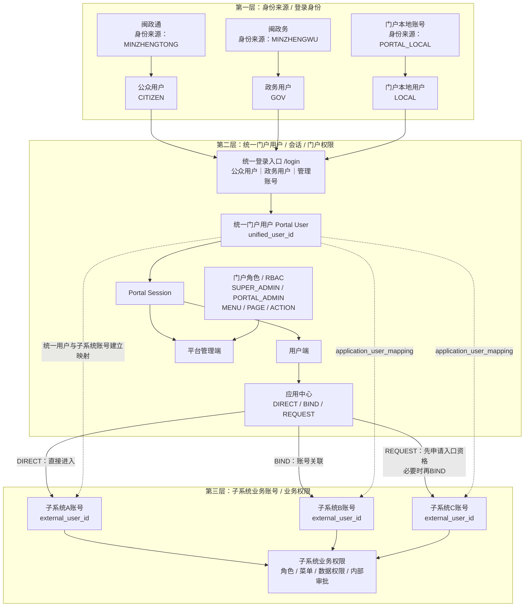
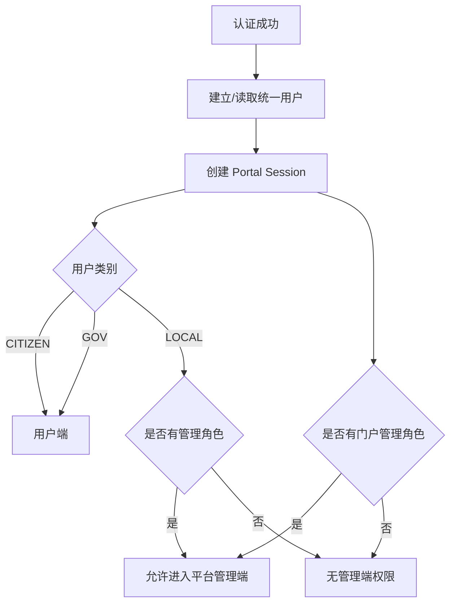
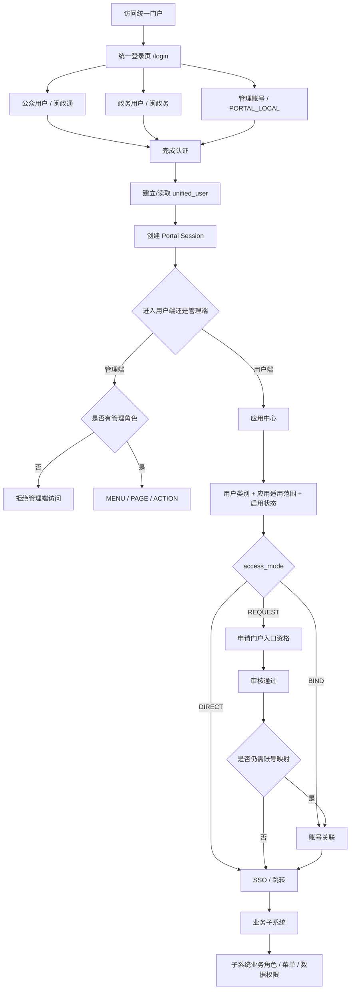

# 统一门户用户体系场景与边界方案 V1.0（统一口径版）

> **适用项目：** 卫健XC统一门户系统  
> **当前目标设计基线：** V20260920-03  
> **当前代码基线：** 0.2.0 P4 Mock 可运行版  
> **文档状态：** 当前需求/设计统一口径  
> **说明：** 本文由《统一门户用户体系场景与边界讨论方案 V0.2》结合当前已确认需求、用户体系、权限体系、应用访问模型和项目现状统一修订形成。  
> **特别说明：** 本文描述的是目标设计口径；其中 `PORTAL_LOCAL / LOCAL`、本地账号密码登录、完整 RBAC、应用访问申请等能力仍需按后续开发计划落地，不能将“已确定方案”误写为“当前代码已全部实现”。

---

# 1. 建设背景

当前整体用户体系分为三个责任层：

| 层级 | 系统类型 | 用户情况 | 当前定位 |
|---|---|---|---|
| 身份来源层 | 闽政通 | 已有公众用户体系 | 公众身份权威来源 |
| 身份来源层 | 闽政务 | 已有政务用户体系 | 政务身份权威来源 |
| 门户自有身份 | 门户本地账号 | 由统一门户维护 | 主要解决门户维护人员不具备闽政通/闽政务账号时的管理端登录 |
| 中间层 | 卫健统一门户 | 本次建设 | 统一入口、统一身份索引、门户 Session、门户角色权限、应用入口资格、账号映射、SSO、待办/消息聚合、公告、日志审计 |
| 下层 | 纳管业务子系统 | 各自存在独立用户/角色/权限体系 | 保留自身业务账号、角色、菜单权限、数据权限和业务审批 |

> 原始需求中业务子系统数量约为 43 个，但当前项目代码/清单仍存在数量口径差异，最终以甲方确认的纳管系统清单为准。本文不再把“43个”作为不可变设计常量。

统一门户不建设面向公众/政务人员的第三套完整身份中心，但允许建设**门户自身的本地用户体系**，用于门户管理员、维护人员、运维人员等管理场景。

推荐总体定位：

> **外部身份认证承接 + 门户本地管理身份 + 统一身份索引 + 门户 RBAC + 应用入口资格 + 跨系统账号映射 + SSO 适配 + 待办/消息聚合 + 日志审计中间层。**

---

# 2. 总体用户体系关系

## 2.1 三层用户及账号关系总览



### 关系说明

| 层级 | 核心对象 | 解决的问题 | 权限边界 |
|---|---|---|---|
| 第一层：身份来源 | 闽政通 / 闽政务 / 门户本地 | 用户通过什么身份完成认证 | 闽政通、闽政务负责外部权威身份；PORTAL_LOCAL只负责门户本地身份 |
| 第二层：统一门户用户 | unified_user / Portal Session / portal_role | 门户识别“当前是谁”、能进入用户端还是管理端、能否获得应用入口资格 | 门户只管理门户自身角色、页面、操作和应用入口资格 |
| 第三层：子系统业务账号 | external_user_id / application_user_mapping | 当前门户用户对应子系统中的哪个账号 | 子系统继续负责自己的账号、角色、菜单、数据权限和内部审批 |

### 三层关系核心链路

```text
身份来源
闽政通 / 闽政务 / PORTAL_LOCAL
        ↓
用户类别
CITIZEN / GOV / LOCAL
        ↓
统一登录 /login
        ↓
统一门户用户 unified_user
        ↓
Portal Session
        ↓
用户端 / 平台管理端
        ↓
应用访问模式 DIRECT / BIND / REQUEST
        ↓
如需BIND：建立 application_user_mapping
        ↓
子系统账号 external_user_id
        ↓
子系统自身业务角色 / 菜单 / 数据权限
```

需要特别区分：

- **身份来源 ≠ 用户类别 ≠ 门户角色**；
- **门户用户 ≠ 子系统业务账号**；
- **门户应用入口资格 ≠ 子系统业务权限**；
- **BIND只解决“门户用户对应哪个子系统账号”，不授予子系统业务角色**；
- 同一个统一门户用户可以关联多个子系统账号；
- 同一个子系统账号同一时间只能存在一个有效门户绑定关系。

推荐责任原则：

> **闽政通 / 闽政务负责“外部用户是谁”；门户本地账号负责“门户维护人员是谁”；统一门户负责“识别、会话、入口资格和门户权限”；业务子系统负责“进入系统后能做什么”。**

---

# 3. 身份来源与用户类别

## 3.1 闽政通

对应关系：

```text
identity_source = MINZHENGTONG
user_type       = CITIZEN
```

原则：

- 闽政通是公众用户权威身份来源；
- 门户不保存闽政通用户密码；
- 门户只保存必要身份索引、展示信息和业务映射；
- 权威姓名、账号、手机号等外部身份字段原则上只读；
- 注册、实名认证、账号安全等由闽政通或其上层能力负责。

---

## 3.2 闽政务

对应关系：

```text
identity_source = MINZHENGWU
user_type       = GOV
```

原则：

- 闽政务是政务用户权威身份来源；
- 门户不创建或维护正式闽政务账号密码；
- 政务组织信息原则上优先来源闽政务；
- 门户保存必要组织索引，但不替代权威组织主数据。

---

## 3.3 门户本地身份

对应关系：

```text
identity_source = PORTAL_LOCAL
user_type       = LOCAL
```

适用：

- 门户超级管理员；
- 门户管理员；
- 项目维护/运维人员；
- 没有闽政通或闽政务账号、但需要维护门户的人员。

原则：

- LOCAL 用户由门户自己维护；
- 门户负责本地账号和密码安全；
- 第一阶段 LOCAL 主要用于管理端；
- LOCAL 用户**不自动等于管理员**；
- 必须拥有有效门户管理角色才能进入平台管理端；
- 不开放普通公众自助注册门户本地账号。

---

# 4. 身份来源、用户类别、门户角色必须分开

三个维度不能混用。

示例：

```text
姓名：张三
身份来源：闽政务
用户类别：政务用户 GOV
门户角色：门户管理员 PORTAL_ADMIN
```

又例如：

```text
账号：admin01
身份来源：门户本地
用户类别：门户本地用户 LOCAL
门户角色：门户超级管理员 SUPER_ADMIN
```

错误设计：

```text
闽政通角色
闽政务角色
公众角色
政务角色
本地用户角色
```

这些都不应作为门户角色。

---

# 5. 统一门户是否存储用户

## 5.1 结论

> **需要保存统一用户索引；对于闽政通/闽政务只保存最小必要信息，对于 LOCAL 额外保存门户自身登录凭证。**

---

## 5.2 建议保存的数据

| 数据类型 | 是否保存 | 说明 |
|---|---|---|
| 统一用户ID | 是 | 门户内部唯一用户索引 |
| 用户类别 | 是 | CITIZEN / GOV / LOCAL |
| 身份来源 | 是 | MINZHENGTONG / MINZHENGWU / PORTAL_LOCAL |
| 外部稳定用户ID | 外部用户保存 | 闽政通/闽政务返回 |
| 最小展示信息 | 是 | 姓名、组织等必要信息 |
| 门户状态 | 是 | 启用/停用 |
| 门户角色 | 是 | SUPER_ADMIN / PORTAL_ADMIN / 自定义扩展 |
| Portal Session | 是（临时） | 门户会话 |
| 应用入口申请/授权 | 是 | REQUEST 模式 |
| 子系统账号映射 | 是 | 用户与子系统账号关系 |
| 登录/访问/操作日志 | 是 | 审计 |
| LOCAL 密码Hash | 是 | 仅本地用户，独立凭证表保存 |
| 外部身份密码 | 否 | 不保存 |
| 子系统明文密码 | 否 | 如一次性校验，仅当次使用 |

---

## 5.3 不完整同步的数据

原则上不完整同步：

- 闽政通全部用户；
- 闽政务全部用户；
- 全部子系统完整用户库；
- 子系统完整角色权限；
- 外部身份密码；
- 子系统密码。

外部用户推荐：

> **首次按需建档 + 登录时刷新 + 必要字段增量同步。**

LOCAL 用户属于门户自有用户，不适用“外部权威身份只读”的限制。

---

# 6. 统一身份模型

## 6.1 当前确认原则

门户维护一个统一用户索引，但**不直接假设闽政通身份和闽政务身份一定能自动合并成同一个自然人**。

当前建议：

- CITIZEN 和 GOV 均可正常独立建立统一用户；
- 若未来需要跨身份源合并，必须由甲方确认：
  - 是否存在稳定、合法、可用于跨源关联的唯一标识；
  - 两个身份源是否允许做身份关联；
  - 冲突时如何处理；
- 不使用姓名作为唯一匹配条件；
- 不建议仅凭手机号自动合并；
- 在跨源关联机制未确认前，不实施自动“公众+政务合并”。

## 6.2 跨身份源候选关联与二次验证

如果未来确需把闽政通CITIZEN与闽政务GOV关联为同一自然人，应采用“候选匹配 + 二次可信验证”，而不是姓名+手机号直接合并。

推荐流程：

```text
闽政通身份 / 闽政务身份
↓
稳定权威跨源ID存在？
├─ 是 → 优先使用权威ID建立关联
└─ 否
   ↓
姓名 + 已验证手机号等条件生成候选
   ↓
本人确认
   ↓
闽政通/闽政务重新认证
   ↓
必要时调用上层更强实名/人脸核验
   ↓
验证通过
   ↓
建立身份关联并保留两个identity_mapping
```

规则：

- 姓名+手机号只能生成候选，不是统一身份主键；
- 手机验证码只能证明用户控制某个已登记手机号，不能单独证明两个外部身份必然属于同一个自然人；
- 优先由闽政通/闽政务提供重新认证、实名核验、人脸核验等增强验证能力，门户不自行采集和保存人脸模板；
- 验证失败、匹配多条或关键信息冲突时不得合并；
- 合并后保留两个外部身份来源及各自external_subject_id，不覆盖任一身份；
- 必须记录关联依据、验证方式、时间和审计记录。

## 6.3 子系统账号关系

一个统一用户可以关联多个业务系统账号：

```text
统一用户 U000001
│
├─ 子系统 A → zhangsan
├─ 子系统 B → ZS001
└─ 子系统 C → user_8276
```

---

# 7. 身份认证、门户登录、门户角色、应用入口与业务权限

必须区分：

```text
身份认证
≠
门户登录
≠
门户管理角色
≠
应用适用范围
≠
门户应用入口资格
≠
子系统账号映射
≠
子系统业务权限
```

例如：

```text
张三通过闽政务认证
        ↓
可以登录统一门户
        ↓
进入应用中心
        ↓
系统A：DIRECT，可直接进入
系统B：BIND，需要关联子系统账号
系统C：REQUEST，需要申请门户入口资格
        ↓
真正进入子系统以后
        ↓
仍由子系统判断角色、菜单和数据权限
```

> 外部身份认证成功，不代表自动拥有全部应用访问资格，更不代表拥有子系统业务权限。

---

# 8. 登录入口设计

## 8.1 统一登录页

当前确认：**用户端和管理端不拆成两套登录页面。**

保留统一：

```text
/login
```

登录页提供三类入口：

```text
统一门户登录页
├─ 公众用户
│  └─ 闽政通
├─ 政务用户
│  └─ 闽政务
└─ 管理账号
   └─ 门户本地账号 + 密码
```

### 公众用户

- 闽政通扫码/手机号等能力；
- 实际认证由上层提供；
- 登录成功默认进入用户端。

### 政务用户

- 闽政务扫码/手机号/免登等能力；
- 实际认证由上层提供；
- 登录成功默认进入用户端；
- 如果该 GOV 用户拥有门户管理角色，可从用户端切换到平台管理端。

### 管理账号

目标正式能力：
- 门户本地账号；
- 密码；
- 登录成功后校验门户管理角色；
- 第一阶段默认直接进入平台管理端。

A阶段原型演示：
- 页面展示用户账号、登录密码、验证码和登录按钮，保持正式系统应有的登录形态；
- 默认账号可使用 `admin01`，密码与验证码仅作演示展示；
- 点击“登录”后直接以 `MOCK_LOCAL_ADMIN / SUPER_ADMIN` 建立Mock Portal Session；
- 不校验账号、密码或验证码；
- 不读取本地数据库。

---

# 9. 登录后的端访问规则



规则：

- CITIZEN / GOV 默认可进入用户端；
- CITIZEN / GOV 如果拥有管理角色，可同时使用管理端；
- LOCAL 第一阶段主要用于管理端；
- LOCAL 没有管理角色时，不自动获得管理端访问权限。

---

# 10. 从上层平台单点进入门户

```text
用户已经登录闽政通/闽政务
        ↓
点击统一门户
        ↓
携带 AuthCode / Ticket / Token
        ↓
门户校验上层认证结果
        ↓
查找 / 建立统一身份索引
        ↓
创建 Portal Session
        ↓
进入统一门户
```

原则：

- 上层已经认证时不重复扫码；
- Portal Session 是门户后续页面/API自己的会话；
- 门户不长期使用上层 Token 代替自身 Session。

---

# 11. 用户直接访问统一门户

## 11.1 公众 / 政务

```text
直接访问 /login
    ↓
选择公众 / 政务
    ↓
发起对应上层认证
    ↓
上层认证成功
    ↓
建立/刷新统一用户
    ↓
创建 Portal Session
    ↓
进入用户端
```

## 11.2 管理账号

```text
直接访问 /login
    ↓
选择“管理账号”
    ↓
A阶段：展示账号/密码/验证码登录表单
    ↓
点击“登录”（输入内容不参与校验）
    ↓
直接以 MOCK_LOCAL_ADMIN 建立 Mock Portal Session
    ↓
进入平台管理端

正式环境：
门户本地账号/密码
    ↓
校验账号状态、锁定、密码
    ↓
校验门户角色
    ↓
创建 Portal Session
    ↓
进入平台管理端
```

---

# 12. 门户本地账号安全

建议至少支持：

- 密码Hash保存；
- 首次登录强制改密；
- 密码重置；
- 连续失败计数；
- 临时锁定；
- 超级管理员解锁；
- 启用/停用；
- 最近登录；
- 密码更新时间；
- 登录、失败、重置、解锁审计。

禁止：

- 明文保存密码；
- 前端返回密码Hash；
- 日志记录密码/Hash；
- 在 Git / Seed 中写死正式超级管理员明文密码。

首个超级管理员建议通过部署初始化方式创建，并设置临时密码或一次性初始化机制。

---

# 13. 门户角色体系

考虑实际维护人员预计只有 1～2 人，第一阶段默认只设置：

| 角色编码 | 角色名称 | 说明 |
|---|---|---|
| SUPER_ADMIN | 门户超级管理员 | 全部门户管理权限和高风险管理能力 |
| PORTAL_ADMIN | 门户管理员 | 日常门户维护能力 |

不默认拆分：

- 应用管理员；
- 公告管理员；
- 集成管理员；
- 审计管理员；
- 身份映射管理员。

底层仍保留 RBAC：

```text
用户
 ↓
门户角色
 ↓
菜单 MENU
 ↓
页面 PAGE
 ↓
操作 ACTION
```

第一阶段两个默认角色数据范围可统一采用：

```text
ALL_PORTAL
```

`ORG / ORG_AND_CHILDREN / ASSIGNED_APPS` 等细粒度数据范围作为后续按需扩展。

---

# 14. 用户端应用中心模型

当前应用中心建议按以下关系组织：

```text
应用中心
├─ 我的应用
├─ 其它可申请 / 可关联应用
└─ 我的申请
```

不使用“收藏应用”作为当前核心能力。

应用是否展示/可进入，需要综合：

```text
用户类别
+ 应用适用范围
+ 应用启用状态
+ access_mode
+ 门户入口资格
+ 子系统账号映射
```

---

# 15. 应用访问模式

当前统一采用：

```text
DIRECT
BIND
REQUEST
```

## 15.1 DIRECT

用户符合适用范围且应用启用后，可直接进入后续 SSO/跳转流程。

```text
满足用户类型
↓
应用启用
↓
DIRECT
↓
SSO / 跳转
```

---

## 15.2 BIND

需要先建立门户统一用户与子系统账号之间的映射。

```text
用户点击应用
↓
未发现账号映射
↓
执行账号关联
↓
建立映射
↓
SSO进入
```

BIND 下进一步配置：

```text
account_binding_mode
├─ AUTO   自动关联
├─ SELF   用户自助关联
├─ REVIEW 审核关联
└─ ADMIN  管理员关联
```

推荐优先级：

> **AUTO → SELF → REVIEW → ADMIN**

管理员主要处理异常、冲突、高权限账号和历史系统，不承担所有用户日常人工绑定。

---

## 15.3 REQUEST

需要先获得**门户应用入口资格**。

```text
用户点击应用
↓
无入口资格
↓
申请使用
↓
PENDING
↓
门户管理员审核
↓
APPROVED / REJECTED
↓
APPROVED 后生成 application_access_grant
↓
如果目标系统仍要求账号映射
↓
继续执行 BIND
↓
SSO进入子系统
```

REQUEST 审核只决定：

> **是否允许从统一门户进入该应用。**

不决定：

- 子系统业务角色；
- 子系统菜单；
- 子系统数据权限；
- 子系统业务审批。

---

# 16. 子系统已有账号但尚未映射

推荐流程：

```text
门户身份认证成功
        ↓
用户点击目标应用
        ↓
发现未建立子系统账号映射
        ↓
根据 account_binding_mode
        ↓
AUTO / SELF / REVIEW / ADMIN
        ↓
子系统返回可信 external_user_id
        ↓
门户建立 application_user_mapping
        ↓
后续 SSO
```

核心原则：

- 只能关联经过本人或可信规则验证的账号；
- 账号验证成功后保存映射关系；
- 如一次性输入子系统密码，密码不落库；
- 关联账号不等于授予业务权限；
- 子系统角色/菜单/数据权限仍由子系统负责。

---

# 17. 子系统账号关联验证方式

## 17.1 跳转子系统认证 / 授权页

推荐优先：

```text
统一门户
↓
关联已有账号
↓
跳转子系统
↓
用户完成子系统认证
↓
子系统返回 external_user_id / ticket
↓
建立映射
```

---

## 17.2 调用子系统认证接口

如果目标系统具备账号校验接口：

- 用户临时输入账号信息；
- 门户调用子系统认证接口；
- 密码只用于当前校验；
- 不保存明文密码；
- 成功后只保存子系统唯一用户ID和映射。

---

## 17.3 可信唯一标识自动匹配

只有在：

- 子系统存在稳定外部唯一身份字段；
- 该字段能够与上层身份可靠匹配；
- 唯一匹配；

才允许 AUTO。

不以姓名作为自动关联依据。

## 17.4 候选匹配与二次验证

当子系统缺少统一人员编码或稳定外部唯一标识时，可使用姓名、手机号、工号、所属组织等信息寻找**候选账号**，但候选匹配本身不等于完成绑定。

推荐规则：

```text
当前门户用户
↓
姓名 + 已登记手机号 / 姓名 + 工号 / 其它受控字段
↓
找到唯一候选子系统账号
↓
进入二次验证
↓
验证通过
↓
建立 application_user_mapping
```

其中：

- 姓名 + 手机号只能作为候选匹配条件，不能直接作为永久唯一键；
- 手机号应优先采用上层身份源或子系统已登记的可信手机号；
- 不得让用户临时输入任意手机号并仅凭该号码验证码完成账号归属认定；
- 匹配到多条记录、账号已被其他统一用户绑定或关键信息冲突时，禁止自动建立映射；
- 二次验证失败不得创建有效 BOUND 映射。

## 17.5 子系统账号二次验证方式

按优先级支持：

1. **子系统跳转认证 / 授权**：优先推荐。门户不接触原系统密码，由子系统完成账号所有权验证并返回一次性凭据和 external_user_id；
2. **子系统登记手机号 OTP**：验证码发送到子系统已有账号中登记的手机号，而不是用户现场新填的号码；
3. **上层身份重新认证**：对敏感系统或需要更高可信度的关联，可再次通过闽政通/闽政务完成身份回验；
4. **子系统账号密码一次性校验**：仅在无法跳转但子系统提供认证接口时使用，账号密码只用于本次调用，不保存、不写日志；
5. **管理员人工审核**：用于高权限账号、冲突数据、历史系统和无法技术验证的账号。

普通账号在 SELF 验证通过后可直接 BOUND；高权限账号可配置为验证成功后进入 REVIEWING，再由管理员审核。

## 17.6 一账号一有效绑定

同一个子系统账号在同一时间只能存在一个有效门户绑定关系：

```text
application_id + external_user_id
→ 最多一个有效 BOUND 映射
```

若该账号已绑定其他 unified_user：

- 禁止后绑定覆盖前绑定；
- 状态进入 CONFLICT；
- 写入 mapping_exception；
- 由管理员核实后处理。

解绑/重绑必须记录审计。高权限账号解绑建议进入审核。

---

# 18. 账号关联异常

以下情况不得自动覆盖：

- 子系统账号已绑定其他统一用户；
- 子系统账号验证失败；
- 子系统账号已停用；
- 一个门户用户匹配多个无法确认账号；
- 一个子系统账号匹配多个门户用户；
- 高权限账号要求审核；
- 子系统缺少可信认证能力；
- 历史手机号/姓名存在冲突。

处理：

```text
正常
→ 自动 / 用户自助完成

异常
→ mapping_exception
→ 管理员审核/处理
```

---

# 19. 子系统无账号时的处理

当前边界需要与原 V0.2 调整：

> **子系统开户由子系统自己决定和处理，统一门户不拥有子系统账号生命周期管理权。**

门户可以根据应用配置提供：

- 提示“尚未开通”；
- 跳转子系统开户/申请入口；
- 调用经子系统明确开放的开户流程接口作为流程触发；
- 展示处理状态。

但：

- 是否开户；
- 开什么账号；
- 默认业务角色；
- 审批规则；
- 开户结果；

均由子系统负责。

因此不再把“门户自动给子系统开户”定义为门户自身权限。

---

# 20. 外部身份源无用户时

当前确认边界：

> **门户不先创建一套可独立替代闽政通/闽政务的公众/政务正式账号。**

公众或政务外部身份不存在时：

```text
访问门户
↓
对应上层身份不存在
↓
跳转 / 引导至闽政通或闽政务相关注册/开通能力
↓
上层创建正式身份
↓
返回门户
↓
建立统一用户索引
```

“门户代理注册上层正式用户”不作为当前默认方案。

只有上层接口和甲方明确确认允许时，才作为后续集成能力评估。

> `PORTAL_LOCAL` 是门户管理身份，不用于替代公众/政务身份注册。

---

# 21. 权限责任边界

## 21.1 闽政通 / 闽政务

负责：

- 外部用户权威身份；
- 正式注册/开户注册；
- 实名认证；
- 外部账号安全；
- 外部身份核心状态；
- 相关扫码/验证码能力。

---

## 21.2 统一门户

负责：

- 统一登录入口；
- 外部身份认证承接；
- PORTAL_LOCAL 本地管理身份；
- Portal Session；
- 统一身份索引；
- 门户角色/RBAC；
- 应用目录；
- 应用适用用户规则；
- DIRECT/BIND/REQUEST；
- 门户应用入口申请和授权；
- 子系统账号映射；
- 映射异常；
- SSO适配；
- 待办/消息聚合；
- 门户公告；
- 登录/访问/操作/API/异常日志。

---

## 21.3 业务子系统

负责：

- 子系统账号本体；
- 子系统开户；
- 子系统账号启停；
- 业务角色；
- 菜单权限；
- 数据权限；
- 业务操作权限；
- 内部审批；
- 高权限账号管理。

推荐总原则：

> **统一身份承接 + 门户入口授权 + 子系统分布式业务授权。**

---

# 22. 推荐数据对象

## 22.1 `unified_user`

建议关键字段：

```text
id
account
name
user_type
identity_source
org_id
org_name
portal_status
first_login_at
last_login_at
created_at
updated_at
```

`user_type`：

```text
CITIZEN
GOV
LOCAL
```

`identity_source`：

```text
MINZHENGTONG
MINZHENGWU
PORTAL_LOCAL
```

---

## 22.2 `portal_local_credential`

仅 LOCAL 使用：

```text
id
user_id
username
password_hash
password_algorithm
must_change_password
failed_login_count
locked_until
password_updated_at
last_login_at
created_at
updated_at
version
```

---

## 22.3 `identity_source`

用于记录外部身份源及门户本地身份类型的配置/识别信息。

建议字段：

```text
identity_source_id
source_code
source_name
source_type
auth_protocol
status
config
```

---

## 22.4 `identity_mapping`

主要用于外部身份与统一用户之间的映射。

```text
unified_user_id
identity_source_id
external_subject_id
external_account
binding_status
last_verified_at
created_at
```

LOCAL 不要求必须产生外部 `identity_mapping`。

---

## 22.5 `portal_role`

默认：

```text
SUPER_ADMIN
PORTAL_ADMIN
```

配套：

```text
portal_permission
portal_role_permission
portal_user_role
```

权限类型：

```text
MENU
PAGE
ACTION
```

---

## 22.6 `application`

关键配置建议包括：

```text
application_id
application_name
application_category
status
applicable_user_types
access_mode
sso_type
account_binding_mode
entry_url
```

`access_mode`：

```text
DIRECT
BIND
REQUEST
```

`account_binding_mode`：

```text
AUTO
SELF
REVIEW
ADMIN```

---

## 22.7 `application_access_request`

```text
request_id
request_no
application_id
user_id
reason
status
submitted_at
reviewed_by
reviewed_at
review_note
version
```

状态：

```text
PENDING
APPROVED
REJECTED
WITHDRAWN
EXPIRED
```

---

## 22.8 `application_access_grant`

```text
grant_id
application_id
user_id
status
granted_by
granted_at
expires_at
```

状态：

```text
ACTIVE
REVOKED
EXPIRED
```

---

## 22.9 `application_user_mapping`

```text
mapping_id
unified_user_id
application_id
external_user_id
external_account
binding_method
binding_status
verified_method
verified_at
bound_at
unbound_at
conflict_reason
created_at
updated_at
```

---

## 22.10 `mapping_exception`

用于保存：

- 冲突；
- 重复；
- 无法验证；
- 高权限待人工审核；
- 映射失败。

---

## 22.11 日志

至少包括：

```text
LOGIN / AUTH
APPLICATION_ACCESS
OPERATION
API
ERROR
```

登录日志必须能区分：

```text
user_type
identity_source
login_source
login_method
result
failure_reason
ip
client
request_id
```

LOCAL：

```text
user_type = LOCAL
identity_source = PORTAL_LOCAL
login_method = PASSWORD
```

---

# 23. 状态模型

## 23.1 门户用户

```text
ENABLED
DISABLED
```

LOCAL 另有临时锁定安全状态。

---

## 23.2 子系统账号映射

建议：

```text
UNBOUND
VERIFYING
REVIEWING
BOUND
FAILED
CONFLICT
```

状态说明：

- UNBOUND：尚未建立映射；
- VERIFYING：候选账号已找到，正在完成账号所有权验证；
- REVIEWING：已完成必要验证，但因高权限/风险策略等待管理员审核；
- BOUND：有效绑定；
- FAILED：验证失败；
- CONFLICT：存在重复绑定、多账号/多用户冲突等异常。

子系统账号启停状态不与映射状态混用；账号是否 ACTIVE/DISABLED/UNKNOWN 作为独立外部账号状态处理。

---

## 23.3 应用访问申请

```text
PENDING
APPROVED
REJECTED
WITHDRAWN
EXPIRED
```

---

## 23.4 应用入口授权

```text
ACTIVE
REVOKED
EXPIRED
```

---

# 24. 管理端功能归属

当前管理端信息架构：

```text
平台管理端

工作台
├─ 管理首页
└─ 通知公告管理

应用管理
├─ 应用列表
├─ 应用访问申请
└─ 运行监控

身份与映射
└─ 身份与子系统映射

系统管理
├─ 用户管理
├─ 角色管理
├─ 组织管理
├─ 字典管理
└─ 配置管理

日志审计
├─ 登录/认证日志
├─ 应用访问日志
├─ 门户操作日志
├─ 接口调用日志
└─ 异常日志
```

说明：

- 不单独设置“身份源管理”一级菜单；
- 身份与子系统关系统一收敛到“身份与映射”；
- 本地账号操作统一在“用户管理”中；
- 门户权限配置并入“角色管理”；
- 应用连接配置并入“应用列表 → 连接配置”；
- 系统分类最终迁入“字典管理”。

---

# 25. 用户端功能

当前用户端：

```text
个人事务
├─ 首页
├─ 待办任务
├─ 消息中心
├─ 通知公告
└─ 个人中心

应用中心
└─ 应用中心
   ├─ 我的应用
   ├─ 其它可申请/可关联应用
   └─ 我的申请
```

关键能力：

- 闽政通登录；
- 闽政务登录；
- 上层免登；
- 我的应用；
- 应用申请；
- 关联已有子系统账号；
- 待办；
- 消息；
- 公告；
- 个人身份摘要。

LOCAL 第一阶段默认不作为普通用户端核心使用对象。

---

# 26. 不纳入统一门户的范围

除非后续明确变更，不建设：

- 闽政通公众用户完整生命周期；
- 闽政务人员完整生命周期；
- 外部用户密码管理；
- 子系统业务角色统一管理；
- 子系统菜单权限统一管理；
- 子系统数据权限集中管理；
- 子系统业务审批；
- 门户替子系统直接决定业务开户；
- 完整复制外部和子系统用户库；
- 长期保存子系统密码；
- 面向公众开放 LOCAL 自助注册。

---

# 27. 当前已经确认的决策项

| 编号 | 决策项 | 当前统一结论 |
|---|---|---|
| D01 | 公众身份权威源 | 闽政通 |
| D02 | 政务身份权威源 | 闽政务 |
| D03 | 门户是否保存用户 | 保存最小统一索引；LOCAL额外保存本地凭证 |
| D04 | 门户是否允许账号密码登录 | 允许，但仅用于 PORTAL_LOCAL / 管理账号 |
| D05 | 用户端和管理端是否分开登录页 | 不分开，统一 `/login` |
| D06 | 统一登录页入口 | 公众用户 / 政务用户 / 管理账号 |
| D07 | 默认门户角色 | SUPER_ADMIN / PORTAL_ADMIN |
| D08 | 用户类别是否等于角色 | 否 |
| D09 | LOCAL是否自动等于管理员 | 否，仍需分配管理角色 |
| D10 | 应用访问模式 | DIRECT / BIND / REQUEST |
| D11 | 子系统账号关联策略 | AUTO / SELF / REVIEW / ADMIN |
| D12 | 应用访问申请通过含义 | 仅授予门户应用入口资格 |
| D13 | 子系统业务权限 | 子系统自行管理 |
| D14 | 子系统开户 | 由子系统决定和处理 |
| D15 | 外部身份注册 | 跳转/使用对应上层身份平台能力 |
| D16 | 我的应用收藏 | 当前不建设收藏能力 |
| D17 | PORTAL_LOCAL主要场景 | 第一阶段主要管理端 |
| D18 | 管理端权限 | MENU / PAGE / ACTION |
| D19 | 第一阶段管理员数据范围 | 默认 ALL_PORTAL |
| D20 | 密码保存 | 仅 LOCAL 保存Hash；不保存外部或子系统明文密码 |

---

# 28. 仍需确认的决策项

| 编号 | 决策项 | 当前状态 |
|---|---|---|
| P01 | 闽政通真实认证接口/回调 | 待接口资料 |
| P02 | 闽政务真实认证接口/回调 | 待接口资料 |
| P03 | 两个身份源是否有合法稳定跨源关联ID | 待确认 |
| P04 | CITIZEN/GOV是否需要合并为同一自然人索引 | 待确认，不自动合并 |
| P05 | LOCAL密码复杂度/有效期/锁定阈值 | 待安全要求确认 |
| P06 | 首个超级管理员初始化方式 | 待部署方案冻结 |
| P07 | 是否启用本地管理账号二次认证 | 待确认 |
| P08 | 最终纳管子系统清单和数量 | 待甲方确认 |
| P09 | 各应用适用公众/政务范围 | 待逐系统确认 |
| P10 | 各应用 DIRECT/BIND/REQUEST 模式 | 待逐系统确认 |
| P11 | BIND应用的 AUTO/SELF/REVIEW/ADMIN 策略 | 待逐系统确认 |
| P12 | 各子系统SSO方式 | 待逐系统摸底 |
| P13 | 子系统是否提供账号查询/校验接口 | 待摸底 |
| P14 | 高权限账号是否必须审核关联 | 待逐系统配置 |
| P15 | 是否允许用户主动解绑/重绑 | 待确认 |
| P16 | 应用入口授权是否设置有效期 | 待确认 |

---

# 29. 纳管业务子系统需要摸底的信息

| 类型 | 需要确认 |
|---|---|
| 系统基本信息 | 系统名称、编码、入口地址、负责人 |
| 适用用户 | 公众 / 政务 / 两者 |
| 用户体系 | 是否有独立用户表 |
| 用户唯一键 | user_id / account / employee_no等 |
| 用户来源 | 自建 / 上级同步 / 其他 |
| 登录方式 | 账号密码 / CAS / OAuth / OIDC / SAML / Token / 自定义 |
| SSO能力 | 是否支持 |
| 用户查询接口 | 是否提供 |
| 账号验证接口 | 是否提供 |
| 外部唯一身份字段 | 是否支持 |
| 账号关联方式 | AUTO / SELF / REVIEW / ADMIN |
| 应用访问模式 | DIRECT / BIND / REQUEST |
| 高权限绑定 | 是否要求审核 |
| 无账号时 | 子系统如何处理开户/申请 |
| 业务角色 | 子系统如何维护 |
| 组织要求 | 是否需要组织信息 |
| SSO返回 | Token / Ticket / Session / Cookie |
| 原登录入口 | 是否保留 |
| 停用处理 | 账号停用后如何返回门户 |

---

# 30. 推荐完整用户访问流程



---

# 31. 当前推荐总体原则

1. **闽政通是公众身份权威源。**
2. **闽政务是政务身份权威源。**
3. **门户允许 PORTAL_LOCAL 本地用户，但其主要服务管理端，不替代公众/政务身份体系。**
4. **统一登录页不拆用户端和管理端。**
5. **登录页提供公众用户、政务用户、管理账号三类入口。**
6. **认证成功后统一建立 Portal Session。**
7. **用户类别与门户角色严格分离。**
8. **默认门户角色只保留 SUPER_ADMIN 和 PORTAL_ADMIN。**
9. **管理端权限按 MENU / PAGE / ACTION 控制。**
10. **应用访问采用 DIRECT / BIND / REQUEST。**
11. **BIND下支持 AUTO / SELF / REVIEW / ADMIN。**
12. **REQUEST批准只代表门户入口资格。**
13. **子系统账号、开户、业务角色、菜单和数据权限仍由子系统负责。**
14. **门户不保存外部身份密码或子系统明文密码。**
15. **LOCAL 密码由门户以Hash方式安全维护。**
16. **不使用姓名作为跨系统唯一身份匹配条件。**
17. **CITIZEN/GOV跨源自然人合并必须等稳定标识和甲方规则确认后再实施。**
18. **最终纳管系统数量和清单不写死，以正式确认清单为准。**

---

# 32. 与 V0.2 相比的主要修订

本版已经统一以下冲突：

1. 原“只有公众/政务两种身份来源” → 增加 `PORTAL_LOCAL / LOCAL`。
2. 原“不建议门户本地账号密码登录” → 改为统一登录页第三入口“管理账号”。
3. 原“门户完全不维护密码” → 改为仅 LOCAL 维护密码Hash，外部身份仍不维护密码。
4. 原“用户端/管理端登录入口逻辑未完全统一” → 明确一个 `/login` + 一个 Portal Session。
5. 原“一人公众+政务身份建议直接合并” → 改为待稳定跨源标识确认，不自动合并。
6. 原“应用访问主要由子系统决定” → 拆分为门户入口资格与子系统业务授权两层。
7. 原“子系统账号处理模式” → 纳入 `BIND` 下的 `account_binding_mode`。
8. 原“上层无用户优先讨论门户代理注册” → 改为优先跳转/使用上层身份平台开户注册能力。
9. 原“门户可主导子系统自动开户/申请开户” → 改为子系统负责开户，门户只做入口、跳转、触发或状态承接。
10. 原管理端菜单与当前项目不一致 → 按当前工作台/应用管理/身份与映射/系统管理/日志审计重构。
11. 原固定“43个系统” → 改为纳管业务子系统，最终数量待正式确认。
12. 原角色模型不足 → 补充 `SUPER_ADMIN / PORTAL_ADMIN` 及 MENU/PAGE/ACTION RBAC。

---

# 33. 文档使用规则

本文作为当前“登录、用户、角色、身份映射、应用入口和子系统账号关系”的统一方案说明。

若与历史讨论稿冲突：

> **以本文及 V20260920-03 当前需求基线为准。**

历史 V0.2 可继续保留用于追溯讨论过程，但不再作为后续开发的权威实现依据。