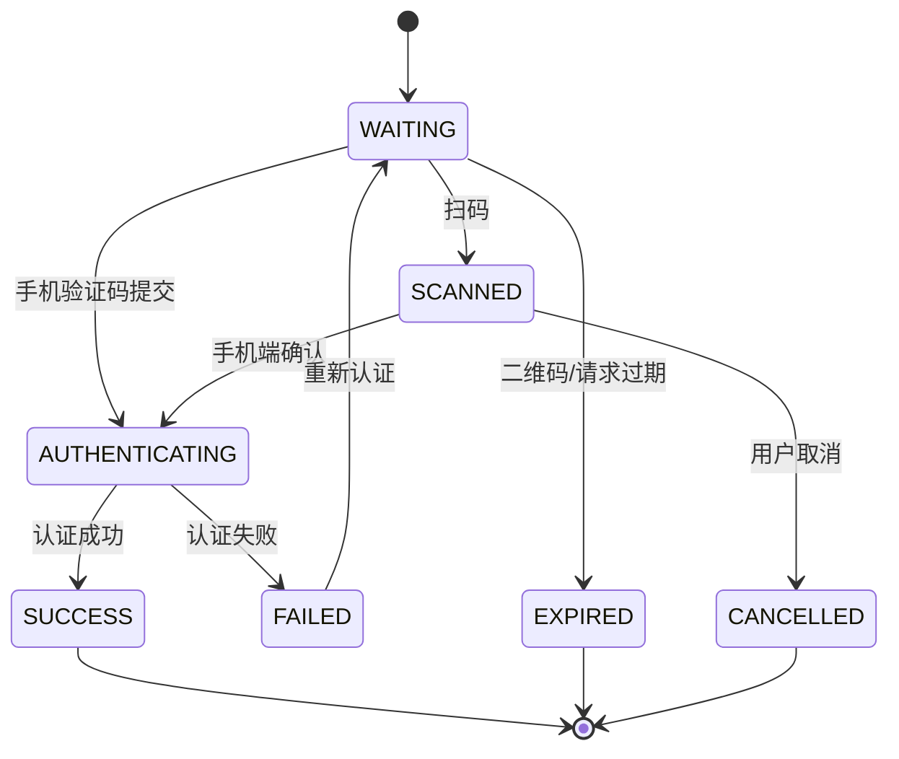
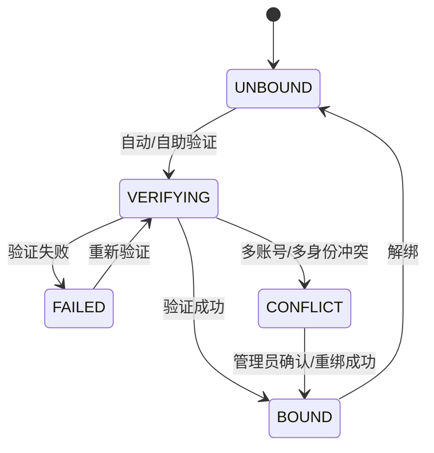
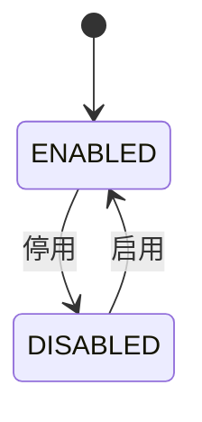
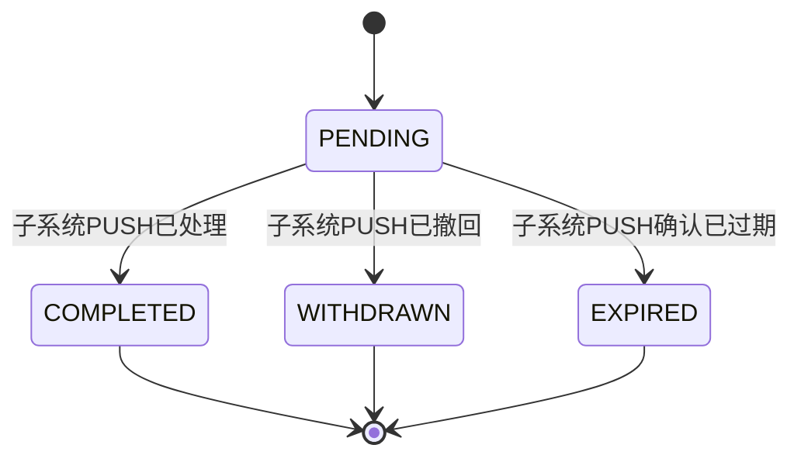
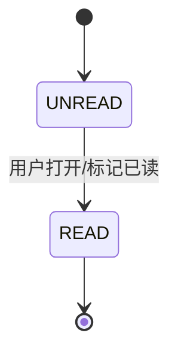
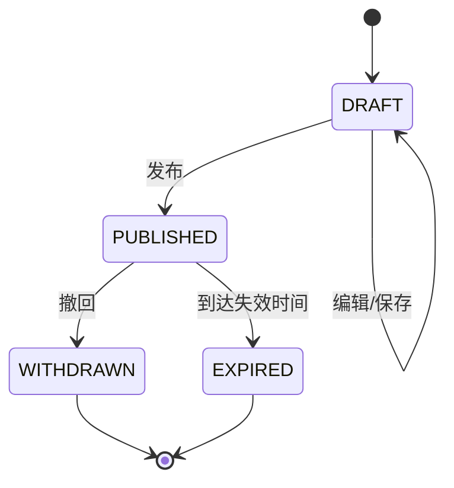
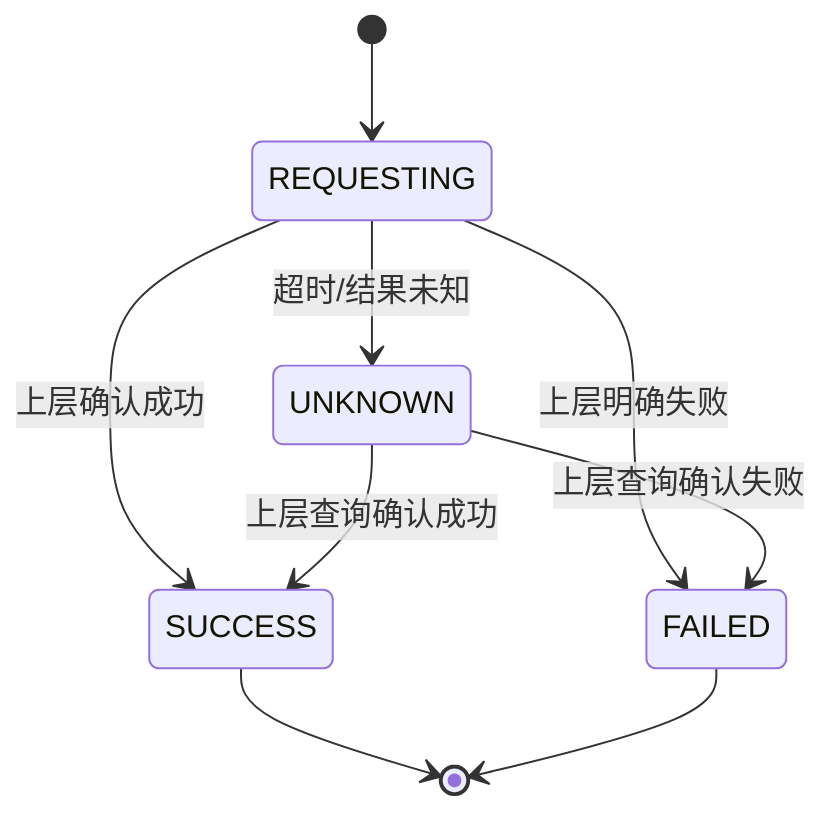

# 状态机

> 状态机仅覆盖有明确生命周期的核心对象。  
> “运行监控正常/异常”等仅作为状态枚举，不构造业务生命周期。

# 1. 登录请求状态机

| 状态值 | 显示名 | 说明 | 终态 | DictType |
|---|---|---|---|---|
| WAITING | 等待认证 | 等待扫码或提交验证码 | 否 | login_request_status |
| SCANNED | 已扫码 | 等待手机端确认 | 否 | login_request_status |
| AUTHENTICATING | 认证中 | 正在调用上层身份认证 | 否 | login_request_status |
| SUCCESS | 成功 | 已建立门户Session | 是 | login_request_status |
| FAILED | 失败 | 本次认证失败，可重新认证 | 否 | login_request_status |
| EXPIRED | 已过期 | 请求/二维码超过有效期 | 是 | login_request_status |
| CANCELLED | 已取消 | 用户取消扫码确认 | 是 | login_request_status |

异常路径：上层服务不可用→FAILED；身份冲突→FAILED并进入异常提示。  
关联检查：记录登录/认证日志；不触发业务消息；匿名权限仅限登录页；测试覆盖成功/失败/过期/取消/上层无账号。

# 2. 子系统账号映射状态机

| 状态值 | 显示名 | 说明 | 终态 | DictType |
|---|---|---|---|---|
| UNBOUND | 未关联 | 当前无有效映射 | 否 | account_mapping_status |
| VERIFYING | 验证中 | 正在核验已有子系统账号 | 否 | account_mapping_status |
| BOUND | 已关联 | 映射有效 | 否 | account_mapping_status |
| FAILED | 关联失败 | 本次验证失败 | 否 | account_mapping_status |
| CONFLICT | 关联冲突 | 存在多账号/多身份冲突 | 否 | account_mapping_status |

异常路径：子系统验证服务不可用→FAILED；高权限账号如需审核，后续可扩展 REVIEWING。  
关联检查：绑定/解绑/重绑进入门户操作履历；冲突可产生门户自身消息但完整触发规则留P6；只有授权管理员可人工处理。

# 3. 应用管理状态机

| 状态值 | 显示名 | 说明 | 终态 | DictType |
|---|---|---|---|---|
| ENABLED | 启用 | 应用可在门户目录中正常提供入口 | 否 | application_status |
| DISABLED | 停用 | 门户不允许正常进入应用 | 否 | application_status |

说明：`NORMAL / ABNORMAL / UNCONFIGURED` 属于运行/接入状态，不与应用启停状态混用。  
关联检查：启停写门户操作日志；停用影响用户进入按钮；不直接改变用户账号映射状态。

# 4. 待办状态机

| 状态值 | 显示名 | 说明 | 终态 | DictType |
|---|---|---|---|---|
| PENDING | 待处理 | 等待用户在子系统办理 | 否 | todo_status |
| COMPLETED | 已处理 | 子系统确认业务已处理 | 是 | todo_status |
| WITHDRAWN | 已撤回 | 源待办已撤回 | 是 | todo_status |
| EXPIRED | 已过期 | 子系统PUSH确认待办已失效 | 是 | todo_status |

异常路径：PUSH重复→幂等忽略；非法状态→拒绝并记录接口日志；用户点击“去处理”不改变状态。  
截止时间仅用于逾期提示，不自动终结待办；EXPIRED必须由子系统PUSH确认。  
关联检查：状态更新写接口日志；P2不定义完整消息提醒规则；留存周期走配置。

# 5. 消息阅读状态机

| 状态值 | 显示名 | 说明 | 终态 | DictType |
|---|---|---|---|---|
| UNREAD | 未读 | 用户尚未阅读 | 否 | message_read_status |
| READ | 已读 | 用户已阅读 | 是 | message_read_status |

异常路径：重复已读操作幂等；子系统是否需要已读回传留后续确认。  
关联检查：不生成额外门户业务消息；消息留存周期配置化。

# 6. 通知公告状态机

| 状态值 | 显示名 | 说明 | 终态 | DictType |
|---|---|---|---|---|
| DRAFT | 草稿 | 未对用户发布 | 否 | announcement_status |
| PUBLISHED | 已发布 | 在发布范围和有效期内展示 | 否 | announcement_status |
| WITHDRAWN | 已撤回 | 管理员主动撤回 | 是 | announcement_status |
| EXPIRED | 已过期 | 到达失效时间 | 是 | announcement_status |

异常路径：发布时缺必填字段/附件上传失败→保持DRAFT并提示；已撤回/过期不可再次直接发布，后续如需“复制再发布”另设计。  
关联检查：新增/编辑/发布/撤回写门户操作履历；发布可产生门户公告展示，不等同于消息通知。

# 7. 上层公共服务调用状态（条件）

仅当门户实际参与上层短信等公共服务调用链路时启用；具体状态以最终上层接口契约为准。

| 状态值 | 显示名 | 说明 | 终态 | DictType |
|---|---|---|---|---|
| REQUESTING | 调用中 | 门户正在调用上层公共服务 | 否 | external_service_call_status |
| SUCCESS | 成功 | 上层确认成功 | 是 | external_service_call_status |
| FAILED | 失败 | 上层明确返回失败 | 是 | external_service_call_status |
| UNKNOWN | 结果未知 | 超时或上层未返回确定结果 | 否 | external_service_call_status |

异常路径：UNKNOWN不得直接按失败处理；是否查询、重试由最终上层契约决定。  
关联检查：调用记录进入接口日志；管理操作由门户管理员（集成管理权限）执行；不建设短信费用统计。

# 8. 运行状态枚举（非状态机）

| 状态值 | 显示名 | 使用对象 |
|---|---|---|
| NORMAL | 正常 | SSO/待办接收/消息接收/短信通道/身份平台 |
| ABNORMAL | 异常 | 同上 |
| UNCONFIGURED | 未配置 | 应用接入能力 |
| DISABLED | 停用 | 被人为停用的接入能力 |

# 9. 状态变化关联检查矩阵

| 对象 | 操作矩阵 | 权限 | 消息 | 操作履历/日志 | P2测试重点 |
|---|---|---|---|---|---|
| 登录请求 | 登录/重试 | 匿名/登录用户 | 不定义业务消息 | 登录/认证日志 | 成功、失败、过期、取消 |
| 账号映射 | 验证/绑定/解绑/重绑 | 用户自助+管理员 | 冲突消息预留 | 映射处理操作日志 | 成功、失败、冲突、解绑 |
| 应用 | 启用/停用 | 门户管理员（应用管理权限） | 无 | 门户操作日志 | 停用后入口不可用 |
| 待办 | 去处理/源状态更新 | 本人查看 | 提醒规则留P6 | 接口调用日志 | 点击不改状态、PUSH更新 |
| 消息 | 查看/已读 | 本人 | 本体即消息 | 阅读时间 | 未读→已读幂等 |
| 公告 | 保存/发布/撤回 | 门户管理员（公告管理权限） | 不自动等同消息 | 操作日志 | 草稿/发布/撤回/过期 |
| 上层公共服务 | 调用/核实（条件） | 调用应用/门户管理员（集成管理权限） | 失败告警留P6 | 发送+操作+接口日志 | 成功、失败、重试上限 |
