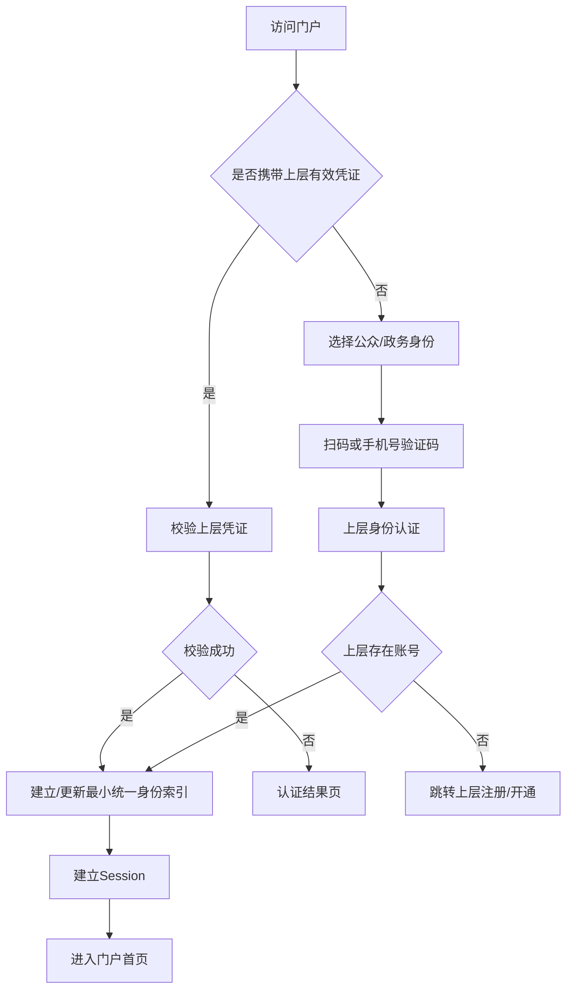
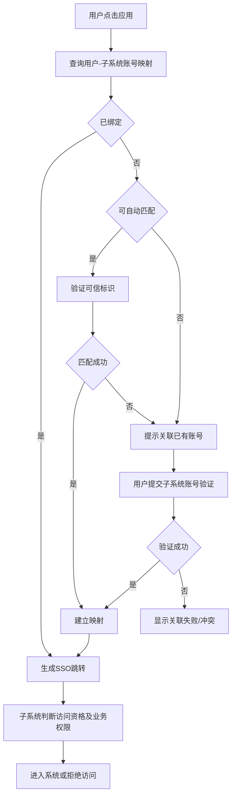
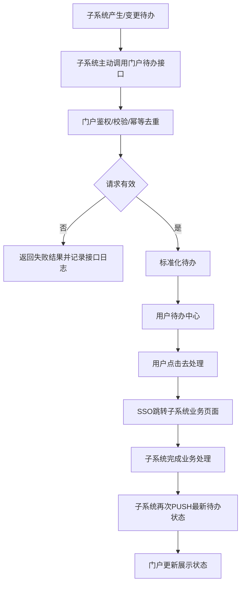
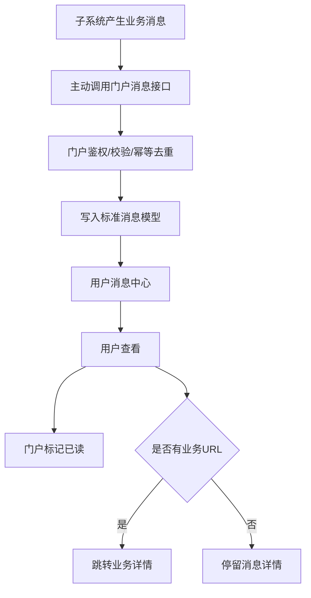
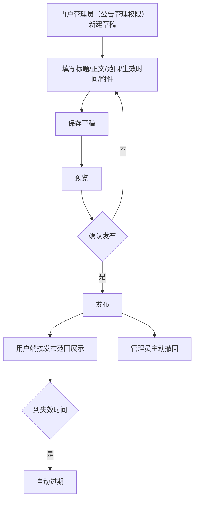
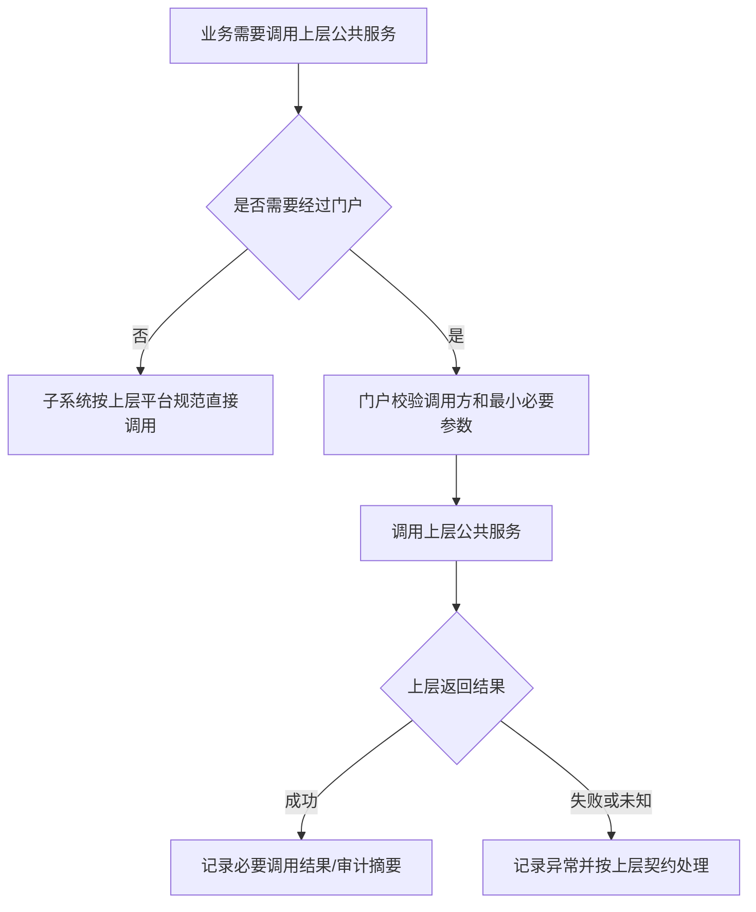
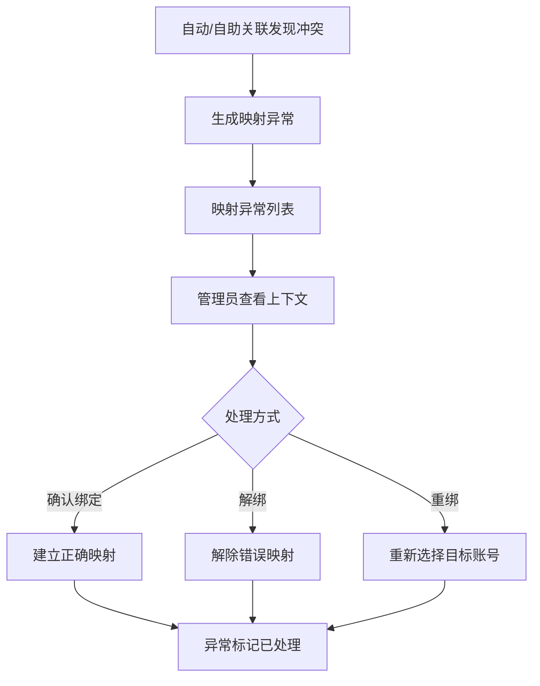

# 业务流程

> P2用于原型和交互闭环。接口协议、数据库实现、鉴权/幂等细节留待后续阶段。

# 1. 登录流程

DEMO：
- 上层认证使用Mock服务模拟成功/失败/未注册/冲突。
- 不冻结实际OIDC/CAS/SAML等协议。

# 2. 应用访问与账号关联

规则：
- 门户不保存子系统明文密码。
- 子系统无账号时，由子系统决定自动开户/申请开户/拒绝访问/提供开户入口。
- “我的应用”不提供收藏。

# 3. 待办PUSH与办理

规则：
- 门户本期不主动拉取子系统待办。
- 用户点击“去处理”不等于待办已处理。
- 待办状态以子系统PUSH结果为准。

# 4. 消息PUSH与阅读

规则：
- 门户不主动拉取子系统消息。
- 子系统是否接收门户已读回传留待后续接口阶段确认。
- 同一业务事项不应无规则同时重复成为“待办”和普通业务消息。

# 5. 通知公告发布

# 6. 上层短信等公共服务调用（条件）

规则：
- 短信等公共能力优先复用上层平台，不默认由门户建设渠道、模板、费用核算。
- 若上层允许子系统直接调用，门户不强制转接。
- 若门户参与链路，只保存最小必要接入配置与审计信息。
- 重试、结果查询、未知状态核实以最终上层接口契约为准，门户不自行假定发送失败或费用。

# 7. 映射异常处理

# 8. 运行监控

运行监控不构造复杂业务状态机：
- 身份平台；
- SSO；
- 待办PUSH接收；
- 消息PUSH接收；
- 短信通道。

统一展示 `正常 / 异常 / 未配置 / 停用`，并允许穿透接口日志。

# 9. 核心状态流转与页面动作交接

本表补齐P2核心流程的执行角色、前置条件和失败表现，与development/状态机的图及枚举配套使用，不改写已确认ADR。接口参数、事务和最终操作矩阵留P3及后续阶段；下列为设计规则，未执行运行验收。

| 对象/当前状态 | 操作 | 执行角色 | 前置条件 | 新状态 | 失败提示/处理 |
|---|---|---|---|---|---|
| 登录/WAITING | 扫码 | 当前认证用户 | 请求未过期且未使用 | SCANNED | 二维码已失效，重新获取 |
| 登录/WAITING或SCANNED | 提交验证码/手机确认 | 当前认证用户 | 当前请求有效，凭据符合身份平台规则 | AUTHENTICATING | 验证失败，保留可重试入口 |
| 登录/AUTHENTICATING | 完成认证 | 身份服务 | 上层核验成功、账号可用且无冲突，最小索引与Session建立成功 | SUCCESS | 任一失败转FAILED，不建立有效会话 |
| 登录/WAITING | 超时 | 系统 | 请求有效期已过 | EXPIRED | 提示重新获取新请求 |
| 登录/SCANNED | 取消 | 当前认证用户 | 请求尚未认证成功 | CANCELLED | 返回登录；再次扫码使用新请求 |
| 登录/FAILED | 重新认证 | 当前认证用户 | 允许重试 | WAITING | 服务不可用时显示错误，不伪造成功 |
| 映射/UNBOUND或FAILED | 自动/自助验证 | 本人/验证服务 | 应用启用、验证能力已配置；自动匹配需可信标识 | VERIFYING | 未配置或无账号，提示子系统处理路径 |
| 映射/VERIFYING | 返回验证结果 | 验证服务 | 已核验对应账号与当前身份关系 | BOUND / FAILED / CONFLICT | 失败允许重试；冲突不得覆盖其他映射 |
| 映射/CONFLICT | 确认绑定/重绑 | 授权门户管理员 | 有可信核验证据，解决唯一性冲突 | BOUND | 无证据或仍冲突保持原状态并说明原因 |
| 映射/BOUND | 解绑 | 授权门户管理员 | 对象存在且有操作权限 | UNBOUND | 失败保持BOUND并记录；不注销子系统账号 |
| 应用/ENABLED | 停用 | 门户管理员（应用管理权限） | 应用存在 | DISABLED | 失败保持原状态；成功禁用入口，不改用户映射 |
| 应用/DISABLED | 启用 | 门户管理员（应用管理权限） | 应用存在 | ENABLED | 失败保持原状态；启用不代表SSO已配置 |
| 待办/PENDING | 去处理 | 目标用户本人 | 应用可进入、SSO/目标地址有效 | PENDING | 跳转失败提示重试，不改业务状态 |
| 待办/PENDING | PUSH业务结果 | 来源子系统 | 鉴权、目标匹配、幂等及状态校验通过 | COMPLETED / WITHDRAWN / EXPIRED | 非法或过时事件拒绝并记录；到期仅提示，EXPIRED必须源系统确认 |
| 消息/UNREAD | 查看/标记已读 | 接收用户本人 | 有查看权限；详情成功加载或明确标记 | READ | 失败保留UNREAD；重复操作幂等 |
| 公告/DRAFT | 编辑/保存 | 授权门户管理员（公告管理权限） | 可编辑，字段符合草稿校验 | DRAFT | 保留输入并说明失败 |
| 公告/DRAFT | 发布 | 授权门户管理员（公告管理权限） | 标题/正文/范围有效、时间合法、附件上传完成 | PUBLISHED | 校验/附件失败保持DRAFT |
| 公告/PUBLISHED | 撤回 | 授权门户管理员（公告管理权限） | 当前仍已发布 | WITHDRAWN | 并发状态改变则刷新并提示 |
| 公告/PUBLISHED | 到期 | 系统 | 存在失效时间且已到达 | EXPIRED | 用户端按有效期控制可见性 |
| 短信/PENDING | 开始发送 | 短信服务 | 已通过应用资格、模板、限制校验 | SENDING | 拒绝请求不进入发送任务；处理异常记录失败原因 |
| 短信/SENDING | 通道结果/超时 | 短信服务 | 匹配当前发送任务 | SUCCESS / FAILED | 成功仅指通道返回成功；超时转FAILED，真实重试前须核对结果，避免重复发送 |
| 短信/FAILED | 重发 | 门户管理员（集成管理权限）/已配置策略 | 可重试、未达上限、无正在发送的相同任务 | SENDING | 不满足时保持FAILED并说明原因 |

终态及关联：登录SUCCESS/EXPIRED/CANCELLED结束该请求；待办COMPLETED/WITHDRAWN/EXPIRED不由前端回退；消息READ重复操作不回退；公告WITHDRAWN/EXPIRED不可直接再次发布；短信SUCCESS终止，FAILED是否终止取决于重试资格。绑定、启停、发布、撤回、人工重发记录操作履历；认证/PUSH/短信记录对应日志。消息触发仍遵循状态机第9节，完整提醒矩阵不在本次冻结。
